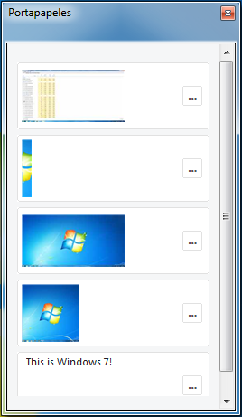
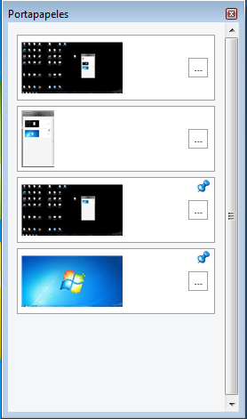
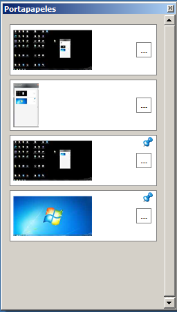
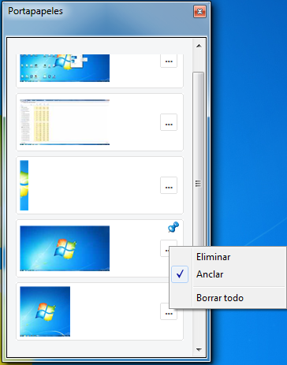
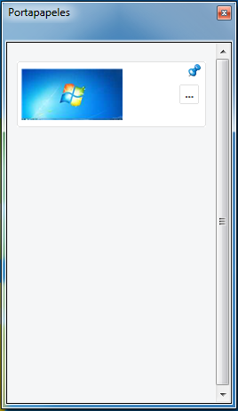
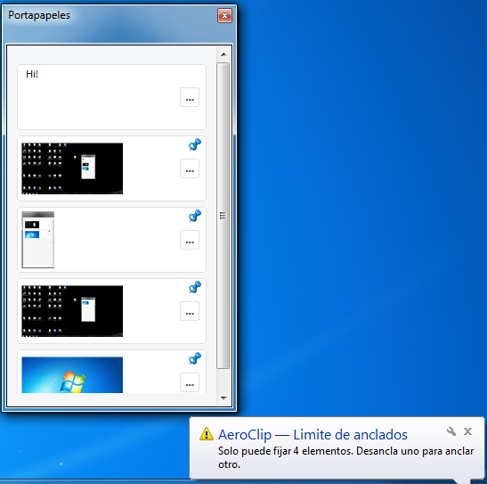

<div align="center">

# AeroClip

A lightweight, native clipboard manager for Windows 7.

Keeps the last ten items you copy, lets you pin up to four of them so they survive a reboot, and pastes back with a single click. The flyout is rendered by GDI, the storage is encrypted with DPAPI, and there is no network code, no service, and no installer.

[Overview](#overview) . [Features](#features) . [Pinning](#pinning) . [Building](#building-from-source) . [Privacy](#privacy-and-security) . [Español](#versión-en-español)

</div>

---

## Overview

AeroClip is a single background executable that registers `Win + V` as a system-wide hotkey and watches the clipboard with `WM_CLIPBOARDUPDATE`. Every time you copy text or an image, the new payload is pushed to the top of a rolling in-memory buffer. Press the hotkey and a small, Aero-themed flyout appears next to the cursor, listing the captured items in reverse chronological order. Click an item to paste it into the focused application; right-click for the standard actions.

The whole project is C++17 over the raw Win32 API. There is no MFC, no .NET runtime, no third-party GUI framework, and no installer. The release binary is statically linked against the C runtime, so it ships as a single `.exe` and runs on a clean Windows 7 install without any prerequisites beyond the system DLLs that already ship with the OS.

## Features

- Global hotkey `Win + V` to toggle the history flyout from anywhere, including full-screen applications.
- Last ten items in a rolling, in-memory buffer.
- Text and image capture. Unicode text is read directly. Bitmaps (DDB) are converted to DIB on the fly because Windows Print Screen typically exposes the capture as `CF_BITMAP` without a matching `CF_DIB`.
- Automatic deduplication of the most recent item, so copying the same snippet twice does not grow the buffer.
- Up to four pinned entries that survive process exit, logoff, reboot, and full power-off.
- One-click paste through `SendInput` with a simulated `Ctrl + V`, plus an `OpenClipboard` retry loop to coexist with the monitor thread without losing the paste.
- Native Windows 7 themes: Aero Glass when DWM composition is on, Basic when themes are enabled without composition, and a faithful Classic rendering for older display paths. The flyout uses the native caption extended with DWM so Aero Glass is preserved on the title bar.
- Automatic language detection between English and Spanish based on the system UI language (`GetUserDefaultUILanguage`). All visible strings adapt to the detected language.
- In-RAM encryption with the Windows Data Protection API (`CryptProtectMemory`, same-process flag). Plain clipboard bytes are only assembled at the moment of paste.
- LZ4 lossless compression for image payloads before they hit disk, so a four-megapixel screenshot lands at well under a megabyte on the pinned store.
- Per-process cleanup of temporary image files on startup and on shutdown. Orphans from previous runs are removed automatically.
- A balloon tip in the notification area is shown when the user attempts to pin more than the configured maximum. The icon is added and immediately deleted in the same notification cycle, so it never lingers in the system tray.
- Zero network activity, zero telemetry, zero background services, zero registry writes, zero scheduled tasks.

### Aero Glass (DWM composition on)



### Basic (themes on, DWM composition off)



### Classic (themes off)



## Pinning

Pinned entries behave differently from regular entries in three ways.

1. They are always rendered at the top of the flyout, regardless of when they were captured.
2. They are protected from automatic eviction when the buffer reaches its limit. The buffer first tries to drop the oldest non-pinned item; if every slot is pinned, the new capture is rejected instead of overwriting a pin.
3. They are persisted to disk the instant the pin action is taken, and reloaded on the next launch. Both text and image pins survive process exit, logoff, reboot, and full power-off.



### Storage layout for pinned items

- Location: `%LOCALAPPDATA%\AeroClip\Pinned\`
- File format: a 28-byte `PinnedHeader` followed by an encrypted body.
- Header fields: magic `ACPB`, format version, item kind, original size, LZ4 size, on-disk size, original capture timestamp.
- Encryption: `CryptProtectData` with the current user scope and no UI prompt, so only the same Windows user can decrypt the file.
- Filename: a 16-hex-digit timestamp followed by the originating process id and the `.acp` extension.

To wipe all pinned items, stop AeroClip, delete the `Pinned` folder, and restart. The buffer for non-pinned items is RAM-only and is cleared automatically when the process exits.



### Pin limit

The maximum number of pinned items is fixed at four. When the user clicks the pin action on a fifth item, AeroClip refuses the change, leaves the buffer unchanged, and shows a balloon tip in the system notification area with the message in the current UI language. The balloon is delivered through the legacy `Shell_NotifyIcon` API because Windows 7 does not route legacy balloons through the Windows Runtime.



## Hotkey reference

| Shortcut   | Action                                            |
| ---------- | ------------------------------------------------- |
| `Win + V`  | Show or hide the history flyout.                  |
| `Esc`      | Close the flyout when it is visible.              |
| `Enter`    | Paste the highlighted entry.                      |
| Click      | Paste the entry under the pointer.                |
| `Delete`   | Remove the highlighted entry.                     |

The hotkey is registered with `MOD_NOREPEAT` so the operating system does not generate repeated hotkey messages while the keys are held down.

## Right-click menu

| Action      | Effect                                             |
| ----------- | -------------------------------------------------- |
| Delete      | Remove the entry from the buffer.                  |
| Pin / Unpin | Toggle the persistent pin state of the entry.      |
| Clear all   | Remove every non-pinned entry. Pinned entries stay.|

## Privacy and security

> AeroClip does not connect to the internet in any way. There is no update check, no analytics, no crash reporting, and no telemetry of any kind.

- The application never opens a socket. There is no `WinHttp`, `WinInet`, `WinSock`, `WSAStartup`, or `InternetOpen` call anywhere in the codebase.
- Pinned text and images are stored only in the current user profile, under `%LOCALAPPDATA%\AeroClip\Pinned\`, encrypted with `CryptProtectData` and readable only by the same Windows user.
- Non-pinned text is held in RAM, encrypted with `CryptProtectMemory` (`CRYPTPROTECTMEMORY_SAME_PROCESS`), and zeroed when the process exits or the entry is removed.
- Non-pinned images are streamed to `%TEMP%\AeroClip\<pid>_<seq>.bin` (LZ4 compressed, then DPAPI-encrypted in place), and the files are deleted on process exit. Orphans from previous runs are removed automatically on startup.
- The release binary does not modify the Windows registry, does not install a service, does not register a scheduled task, and does not place itself in any startup location.
- The release binary is statically linked against the C runtime. It depends only on the system DLLs that ship with Windows 7: `kernel32`, `user32`, `gdi32`, `gdiplus`, `shell32`, `ole32`, `uxtheme`, `dwmapi`, `crypt32`.

## Building from source

### Requirements

- Windows 7 SP1 or later for development. The produced binary targets Windows 7.
- Visual Studio 2017 or newer with the C++ workload.
- The Windows 10 SDK (the project sets `WindowsTargetPlatformVersion` to `10.0`, but the codebase only uses APIs available on Windows 7).

### Build

1. Open `AeroClip\AeroClip.sln` in Visual Studio.
2. Select the `Release` configuration and either `Win32` or `x64`.
3. Build the solution. The output is a single `AeroClip.exe` of roughly two hundred kilobytes.

### Editing the version

The single source of truth for the executable version is `include\Version.h`. Edit the four macros `AEROCLIP_VERSION_MAJOR`, `AEROCLIP_VERSION_MINOR`, `AEROCLIP_VERSION_PATCH`, and `AEROCLIP_VERSION_BUILD`, rebuild, and the new numbers flow into the `VS_VERSION_INFO` resource, the About box, and any log line that prints the version.

### Localization

`include\UI\Localization.h` exposes a `Loc*()` family of functions that return the localized string for the current system language. The detection runs once on first use and caches the result. To add a new language, extend the `Language` enum, add a `Loc*()` overload that switches on it, and update `DetectSystemLanguage` to recognise the new primary language id.

## Project layout

```
AeroClip/
  AeroClip/
    AeroClip.sln
    AeroClip.vcxproj
    AeroClip.vcxproj.filters
    main.cpp                # WinMain, host window, balloon tip glue
    Resource.rc             # VS_VERSION_INFO (sourced from Version.h)
    app.manifest            # Common-Controls v6, Win7 + Vista compat ids
  include/
    AeroClip.h              # Common types, constants, PinnedHeader
    Version.h               # Centralized version metadata
    Clipboard/
      ClipboardMonitor.h    # WM_CLIPBOARDUPDATE listener thread
      DataConverter.h       # CF_UNICODETEXT, CF_DIB, CF_BITMAP fallback
    Core/
      HotkeyManager.h       # RegisterHotKey / UnregisterHotKey
      FlyoutWindow.h        # Main flyout, painting, scrollbar, context menu
    Storage/
      HistoryBuffer.h       # Item store, pin persistence, LZ4 + DPAPI
    UI/
      ItemRenderer.h        # Card, thumbnail, badge, text label
      ThemeEngine.h         # Aero / Basic / Classic detection and palette
      Localization.h        # EN/ES string table
    Utils/
      InputInjector.h       # SendInput-driven Ctrl+V
  src/
    Clipboard/
      ClipboardMonitor.cpp
      DataConverter.cpp
    Core/
      HotkeyManager.cpp
      FlyoutWindow.cpp
    Storage/
      HistoryBuffer.cpp
      lz4.c / lz4.h         # In-tree LZ4 (BSD-2, Yann Collet)
    UI/
      ItemRenderer.cpp
      ThemeEngine.cpp
    Utils/
      InputInjector.cpp
  LICENSE                   # GNU General Public License v3.0
  README.md                 # This file
```

## License

AeroClip is released under the GNU General Public License v3.0. See `LICENSE` for the full text.

---

# Versión en Español

<div align="center">

Gestor de portapapeles nativo y ligero para Windows 7.

Conserva los últimos diez elementos que copies, permite anclar hasta cuatro para que sobrevivan a un reinicio, y los pega de nuevo con un solo clic. El flyout se dibuja con GDI, el almacenamiento está cifrado con DPAPI, y no hay código de red, ni servicios, ni instalador.

[Descripción general](#descripción-general) . [Funcionalidades](#funcionalidades) . [Anclaje](#anclaje) . [Compilar](#compilar-desde-el-código-fuente) . [Privacidad](#privacidad-y-seguridad)

</div>

---

## Descripción general

AeroClip es un único ejecutable en segundo plano que registra `Win + V` como hotkey global y observa el portapapeles con `WM_CLIPBOARDUPDATE`. Cada vez que copias texto o una imagen, el nuevo contenido se inserta en la parte superior de un búfer circular en memoria. Pulsa el hotkey y aparece un flyout pequeño con tema Aero junto al cursor, listando los elementos en orden cronológico inverso. Haz clic en un elemento para pegarlo en la aplicación enfocada; clic derecho para las acciones estándar.

Todo el proyecto es C++17 sobre la API nativa de Win32. No hay MFC, ni runtime .NET, ni frameworks de terceros, ni instalador. El binario de release se enlaza estáticamente contra el runtime de C, de modo que se distribuye como un único `.exe` y funciona en una instalación limpia de Windows 7 sin prerrequisitos más allá de las DLL del sistema.

## Funcionalidades

- Hotkey global `Win + V` para mostrar u ocultar el flyout desde cualquier sitio, incluso en aplicaciones a pantalla completa.
- Últimos diez elementos en un búfer circular en memoria.
- Captura de texto e imágenes. El texto Unicode se lee directamente. Los bitmaps (DDB) se convierten a DIB sobre la marcha, porque la tecla `Impr Pant` de Windows suele exponer la captura como `CF_BITMAP` sin un `CF_DIB` asociado.
- Deduplicación automática del elemento más reciente: copiar dos veces lo mismo no infla el búfer.
- Hasta cuatro elementos anclados que sobreviven al cierre del proceso, al cierre de sesión, al reinicio y al apagado completo del equipo.
- Pegado con un solo clic mediante `SendInput` simulando `Ctrl + V`, con reintentos sobre `OpenClipboard` para convivir con el hilo monitor sin perder el pegado.
- Temas nativos de Windows 7: Aero Glass cuando la composición DWM está activa, Basic cuando hay temas sin composición, y un render Classic fiel para configuraciones más antiguas. El flyout usa la barra de título nativa extendida con DWM para preservar el Aero Glass.
- Detección automática de idioma entre inglés y español basada en el idioma de la UI del sistema (`GetUserDefaultUILanguage`). Todas las cadenas visibles se adaptan al idioma detectado.
- Cifrado en RAM con la API de protección de datos de Windows (`CryptProtectMemory`, indicador same-process). Los bytes en plano del portapapeles solo se ensamblan en el momento del pegado.
- Compresión sin pérdida LZ4 sobre las imágenes antes de escribirlas a disco, de modo que una captura de cuatro megapíxeles ocupa mucho menos de un megabyte en el almacén de anclados.
- Limpieza por PID de los archivos temporales de imagen al arrancar y al cerrar. Los huérfanos de ejecuciones anteriores se eliminan automáticamente.
- Globo de notificación en el área de notificación cuando el usuario intenta anclar más del máximo configurado. El icono se añade y se elimina de inmediato en el mismo ciclo, por lo que nunca queda visible en la bandeja del sistema.
- Cero actividad de red, cero telemetría, cero servicios en segundo plano, cero escrituras en el registro, cero tareas programadas.

### Aero Glass (composición DWM activada)


### Básico (temas activados, composición DWM desactivada)


### Clásico (temas desactivados)


## Anclaje

Los elementos anclados se comportan de forma diferente al resto en tres sentidos.

1. Siempre se renderizan en la parte superior del flyout, independientemente de cuándo se capturaron.
2. Están protegidos del eviction automático cuando el búfer llega a su límite. El búfer intenta primero descartar el elemento no anclado más antiguo; si todas las ranuras están ancladas, la nueva captura se rechaza en lugar de sobrescribir un pin.
3. Se persisten a disco en el instante del anclaje y se recargan en el siguiente arranque. Tanto los anclados de texto como de imagen sobreviven al cierre del proceso, al cierre de sesión, al reinicio y al apagado completo del equipo.


### Disposición del almacenamiento de anclados

- Ubicación: `%LOCALAPPDATA%\AeroClip\Pinned\`
- Formato del archivo: una `PinnedHeader` de 28 bytes seguida de un cuerpo cifrado.
- Campos de la cabecera: magic `ACPB`, versión del formato, tipo de elemento, tamaño original, tamaño LZ4, tamaño en disco, timestamp original de captura.
- Cifrado: `CryptProtectData` con el ámbito del usuario actual y sin prompt de UI, de modo que solo el mismo usuario de Windows puede descifrar el archivo.
- Nombre del archivo: timestamp de 16 dígitos hexadecimales, seguido del identificador del proceso de origen y la extensión `.acp`.

Para borrar todos los anclados, detén AeroClip, elimina la carpeta `Pinned` y reinicia. El búfer de elementos no anclados es solo RAM y se limpia automáticamente al salir del proceso.


### Límite de anclados

El número máximo de elementos anclados es cuatro. Cuando el usuario hace clic en anclar sobre un quinto elemento, AeroClip rechaza el cambio, deja el búfer como está y muestra un globo de notificación en el área de notificación del sistema con el mensaje en el idioma de UI actual. El globo se entrega mediante la API legacy `Shell_NotifyIcon` porque Windows 7 no enruta los globos legacy a través del Windows Runtime.


## Atajos de teclado

| Atajo       | Acción                                                |
| ----------- | ----------------------------------------------------- |
| `Win + V`   | Mostrar u ocultar el flyout del historial.            |
| `Esc`       | Cerrar el flyout si está visible.                     |
| `Enter`     | Pegar la entrada resaltada.                           |
| Clic        | Pegar la entrada bajo el puntero.                     |
| `Suprimir`  | Eliminar la entrada resaltada.                        |

El hotkey se registra con `MOD_NOREPEAT` para que el sistema operativo no genere mensajes repetidos mientras las teclas permanecen pulsadas.

## Menú contextual

| Acción          | Efecto                                                |
| --------------- | ----------------------------------------------------- |
| Eliminar        | Quita la entrada del búfer.                           |
| Anclar / Desanclar | Alterna el estado de anclaje persistente.          |
| Borrar todo     | Quita todas las entradas no ancladas. Las ancladas se conservan. |

## Privacidad y seguridad

> AeroClip no se conecta a internet de ninguna forma. No hay comprobación de actualizaciones, ni analíticas, ni reporte de errores, ni telemetría de ningún tipo.

- La aplicación nunca abre un socket. No hay ninguna llamada a `WinHttp`, `WinInet`, `WinSock`, `WSAStartup` o `InternetOpen` en el código.
- Los anclados de texto e imagen se almacenan únicamente en el perfil del usuario actual, en `%LOCALAPPDATA%\AeroClip\Pinned\`, cifrados con `CryptProtectData` y solo legibles por el mismo usuario de Windows.
- El texto no anclado se mantiene en RAM, cifrado con `CryptProtectMemory` (`CRYPTPROTECTMEMORY_SAME_PROCESS`), y se sobrescribe con ceros cuando el proceso sale o la entrada se elimina.
- Las imágenes no ancladas se vuelcan a `%TEMP%\AeroClip\<pid>_<seq>.bin` (comprimidas con LZ4 y luego cifradas in-place con DPAPI), y los archivos se eliminan al cerrar el proceso. Los huérfanos de ejecuciones anteriores se eliminan automáticamente al arrancar.
- El binario de release no modifica el registro de Windows, no instala servicios, no registra tareas programadas y no se coloca en ninguna ubicación de inicio.
- El binario de release se enlaza estáticamente contra el runtime de C. Solo depende de las DLL del sistema que vienen con Windows 7: `kernel32`, `user32`, `gdi32`, `gdiplus`, `shell32`, `ole32`, `uxtheme`, `dwmapi`, `crypt32`.

## Compilar desde el código fuente

### Requisitos

- Windows 7 para su ejecución. El binario producido está orientado a Windows 7.
- Visual Studio 2017 o más reciente con la carga de trabajo de C++.
- El SDK de Windows 10 (el proyecto define `WindowsTargetPlatformVersion` como `10.0`, pero el código solo usa APIs disponibles en Windows 7).

### Compilar

1. Abre `AeroClip\AeroClip.sln` en Visual Studio.
2. Selecciona la configuración `Release` y la plataforma `Win32` o `x64`.
3. Compila la solución. La salida es un único `AeroClip.exe` de aproximadamente doscientos kilobytes.

### Editar la versión

La fuente única de verdad para la versión del ejecutable es `include\Version.h`. Edita los cuatro macros `AEROCLIP_VERSION_MAJOR`, `AEROCLIP_VERSION_MINOR`, `AEROCLIP_VERSION_PATCH` y `AEROCLIP_VERSION_BUILD`, recompila, y los nuevos números fluyen hacia el recurso `VS_VERSION_INFO`, el cuadro Acerca de y cualquier línea de log que imprima la versión.

### Localización

`include\UI\Localization.h` expone una familia de funciones `Loc*()` que devuelven la cadena localizada para el idioma del sistema. La detección se ejecuta una vez en el primer uso y se cachea. Para añadir un idioma, amplía el enumerado `Language`, añade una sobrecarga `Loc*()` que conmute sobre él y actualiza `DetectSystemLanguage` para reconocer el nuevo identificador de idioma principal.

## Estructura del proyecto

```
AeroClip/
  AeroClip/
    AeroClip.sln
    AeroClip.vcxproj
    AeroClip.vcxproj.filters
    main.cpp                # WinMain, ventana host, glue del balloon
    Resource.rc             # VS_VERSION_INFO (desde Version.h)
    app.manifest            # Common-Controls v6, ids de compat. Win7 + Vista
  include/
    AeroClip.h              # Tipos comunes, constantes, PinnedHeader
    Version.h               # Metadatos de versión centralizados
    Clipboard/
      ClipboardMonitor.h    # Hilo listener de WM_CLIPBOARDUPDATE
      DataConverter.h       # Fallback CF_UNICODETEXT, CF_DIB, CF_BITMAP
    Core/
      HotkeyManager.h       # RegisterHotKey / UnregisterHotKey
      FlyoutWindow.h        # Flyout principal, pintura, scroll, menú
    Storage/
      HistoryBuffer.h       # Almacén, persistencia de pins, LZ4 + DPAPI
    UI/
      ItemRenderer.h        # Tarjeta, miniatura, badge, etiqueta
      ThemeEngine.h         # Detección Aero / Basic / Classic y paleta
      Localization.h        # Tabla de cadenas EN/ES
    Utils/
      InputInjector.h       # Ctrl+V simulado con SendInput
  src/
    Clipboard/
      ClipboardMonitor.cpp
      DataConverter.cpp
    Core/
      HotkeyManager.cpp
      FlyoutWindow.cpp
    Storage/
      HistoryBuffer.cpp
      lz4.c / lz4.h         # LZ4 embebido (BSD-2, Yann Collet)
    UI/
      ItemRenderer.cpp
      ThemeEngine.cpp
    Utils/
      InputInjector.cpp
  LICENSE                   # GNU General Public License v3.0
  README.md                 # Este archivo
```

## Licencia

AeroClip se distribuye bajo la GNU General Public License v3.0. Consulta `LICENSE` para el texto completo.